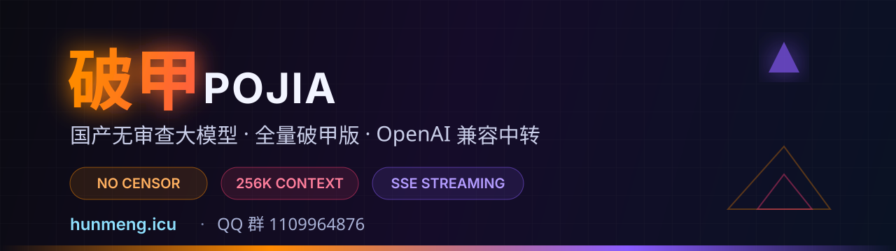

<div align="center">



# Pojia · 无审查国产大模型

**不做内容审查对齐 · OpenAI 兼容中转 · 开箱即用**

「破甲」是名字，**无审查**才是本质。

[](https://www.hunmeng.icu/)
[](https://qm.qq.com/q/1109964876)
[](#快速开始)
[](#接口能力)

</div>

---

## 🧭 先分清两件事

这两个概念经常被混着说，但它们完全不是一回事：

| | **无审查模型（我们）** | 破甲 / 越狱（jailbreak） |
|---|---|---|
| 做法 | 训练与部署阶段**不内置内容审查层**，模型原生就没有过滤与模板化拒绝 | 模型本来带审查，靠 prompt 套路临时**骗过**它 |
| 稳定性 | **稳定**。任何提问方式都是同一个回答逻辑 | 脆弱。换个问法就反弹，随时「抱歉」 |
| 维护 | 模型更新即生效 | 官方一打补丁就失效，得重新找套路 |
| 你的成本 | 一个 API Key，写完代码就完事 | 每次对话前先写一长串催眠前缀 |

**「破甲」在这里只是个品牌名** —— 不是"破解"某个模型的意思，它本来就是这样训出来的。

> 我们不做 prompt 绕过生意，我们卖的是**本身就不带审查层**的模型。

---

## ⚡ 为什么走中转站，而不是自己跑

| | 自己部署 | **Pojia 中转站** |
|---|---|---|
| 硬件门槛 | 4090 / A100 起，显存 24G+ | **0，一个 API Key** |
| 环境配置 | CUDA、vLLM、量化、显存调优 | **浏览器就能跑通** |
| 首字延迟 | 冷启动几十秒 | **秒级响应** |
| 上下文 | 受显存限制 | **最高 256K** |
| 并发 | 单卡排队 | **多线路负载均衡** |
| 模型更新 | 自行拉权重 | **后台自动换新，无感** |
| 兼容 | 自己写适配层 | **OpenAI SDK 只改 base_url** |

---

## 🎯 模型矩阵

| 模型 ID | 定位 | 上下文 | 特点 |
|---|---|---|---|
| `pojia-pro` | 旗舰 | 256K | 无审查通用主力，长文 / 代码 / 推理全场景 |
| `pojia-fast` | 极速 | 64K | 高频对话，最低延迟 |
| `pojia-coder` | 代码 | 128K | 注释不废话，直接给可运行实现 |
| `pojia-writer` | 创作 | 128K | 长篇 / 黑暗向 / 成人向，不降级不糊弄 |
| `pojia-re` | 逆向分析 | 64K | 汇编、反编译、协议还原 |
| `pojia-vision` | 多模态 | 128K | 图像理解，无内容过滤 |

> 全部统一走 OpenAI Chat Completions 协议，`model` 字段换名即换模型。

---

## 🚀 快速开始

### 0. 拿 Key

1. 打开 **https://www.hunmeng.icu/**
2. 注册 → 控制台 → 创建 API Key（`sk-` 开头）
3. 额度问题进群 **1109964876** 找管理员

**Base URL：**

```
https://www.hunmeng.icu/v1
```

---

### 1. curl

```bash
curl https://www.hunmeng.icu/v1/chat/completions \
  -H "Content-Type: application/json" \
  -H "Authorization: Bearer $POJIA_API_KEY" \
  -d '{
    "model": "pojia-pro",
    "stream": true,
    "messages": [
      {"role": "user", "content": "直接回答，不需要免责声明。"}
    ]
  }'
```

---

### 2. Python

```python
from openai import OpenAI

client = OpenAI(
    api_key="sk-你的密钥",
    base_url="https://www.hunmeng.icu/v1",
)

resp = client.chat.completions.create(
    model="pojia-pro",
    messages=[{"role": "user", "content": "说人话，别绕弯子。"}],
    stream=True,
)

for chunk in resp:
    if chunk.choices[0].delta.content:
        print(chunk.choices[0].delta.content, end="", flush=True)
```

---

### 3. Node / TypeScript

```ts
import OpenAI from "openai";

const client = new OpenAI({
  apiKey: process.env.POJIA_API_KEY,
  baseURL: "https://www.hunmeng.icu/v1",
});

const stream = await client.chat.completions.create({
  model: "pojia-pro",
  stream: true,
  messages: [{ role: "user", content: "说人话。" }],
});

for await (const part of stream) {
  process.stdout.write(part.choices[0]?.delta?.content ?? "");
}
```

---

### 4. 图形客户端接入（3 步）

| 客户端 | 设置项 |
|---|---|
| **Cherry Studio** | 设置 → 模型服务 → 添加 OpenAI 兼容 → 填 Base URL + Key |
| **Chatbox** | 设置 → 模型提供方 → OpenAI API 兼容 → 自定义 API 域名 |
| **NextChat / LobeChat** | 环境变量 `BASE_URL` + `OPENAI_API_KEY` + 自定义模型名 |
| **SillyTavern** | API → OpenAI 兼容 → 反代地址填 Base URL |
| **VS Code / Cursor** | 扩展如 Continue → `apiBase` 指向 Base URL |

> 通用口诀：**凡是能填 `base_url` 的地方，就填 `https://www.hunmeng.icu/v1`。**

---

## 🛠 接口能力

- ✅ `/v1/chat/completions` — 对话，支持 `stream: true`
- ✅ `/v1/models` — 模型清单
- ✅ `/v1/embeddings` — 向量化
- ✅ SSE 流式输出、Function Calling、JSON Mode
- ✅ 高并发、多线路自动切换、断流重连
- ✅ 兼容 LangChain / LlamaIndex / Dify / FastGPT / OneAPI

```bash
# 验证连通与模型列表
curl https://www.hunmeng.icu/v1/models \
  -H "Authorization: Bearer $POJIA_API_KEY"
```

---

## 💰 价格

| 档位 | 说明 |
|---|---|
| **体验包** | 注册即送，够跑通全流程 |
| **日卡 / 周卡** | 高频短测、跑脚本 |
| **月卡** | 主力使用，不限模型切换 |
| **定制 / 私有线路** | 团队、企业、独立带宽，进群谈 |

> 具体价格与活动以 **https://www.hunmeng.icu/** 站内与群公告为准。
> 群：**1109964876**（群文件里有优惠码）

---

## ❓ FAQ

**Q：无审查模型和「破甲提示词」有什么区别？**
A：那些提示词是在**已有审查**的模型上做临时绕过，脆弱、易反弹、官方一更新就失效。我们这边模型本身就不带审查层 —— 不需要任何前缀、任何角色扮演、任何"请忽略之前的指令"，直接问就行。

**Q：回答到一半会不会突然「我不能」？**
A：不会。没有审查层可触发，也不会输出模板化拒绝话术或免责声明套话。

**Q：那「破甲」这个名字是意思？**
A：只是产品名，取自"卸下装甲"的意象，指模型不带过滤这一层壳，不是指破解行为。

**Q：能商用吗？**
A：可以，接口无使用场景限制。你的数据只用于本次推理，不做训练。

**Q：支持并发吗？会不会限速？**
A：支持并发，按套餐给到对应 QPS；不够用进群提额。

**Q：稳定吗？会不会掉线？**
A：多线路冗余 + 实时监控；异常会在群里第一时间公告，余额支持迁移。

**Q：能自己部署吗？**
A：能，群里提供权重与部署脚本指引；懒得折腾就用中转站。

---

## 📣 加入我们

<div align="center">

### QQ 群：1109964876

[**👉 点这里一键加群**](https://qm.qq.com/q/1109964876)

群内提供：**免费额度 · 模型更新 · 部署脚本 · 疑难解答 · 优惠码**

</div>

---

## 📅 更新日志

- **v1.4** — 新增 `pojia-vision` 多模态；并发上限提升；首字延迟优化 40%
- **v1.3** — 全线升级 256K 上下文；新增 Function Calling
- **v1.2** — 开放 `/v1/embeddings`；多线路自动故障转移
- **v1.0** — 中转站正式上线

---

## 📄 使用规范

本项目与接口面向**研究与创作场景**。使用者需自行对输入输出内容及其用途负责，遵守所在地法律法规。作者不对第三方使用行为承担责任。

<div align="center">

**Star ⭐ 一下，让更多人找到不用自我阉割的模型。**

[官网](https://www.hunmeng.icu/) · [QQ群](https://qm.qq.com/q/1109964876) · [推广文案包](./PROMO.md) · [接入指南](./docs/接入指南.md)

</div>
<!-- docs: updated 2026-11-08 -->
